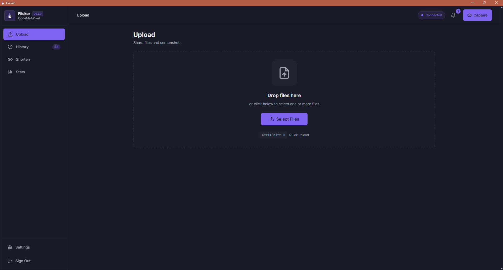

# Flicker

<div align="center">




[](https://github.com/EmberlyOSS/Flicker/releases)
[](LICENSE)
[](https://embrly.ca/discord)
[](https://github.com/EmberlyOSS/Flicker)

</div>

---

## Features

- **Screenshot capture** — fullscreen or all-monitors capture via global hotkeys
- **Instant upload** — screenshots and files upload straight to your Emberly account
- **Clipboard integration** — upload the image currently on your clipboard, and get the result URL copied back automatically
- **Desktop notifications** — get notified when an upload completes
- **Upload history** — searchable, filterable, sortable history with previews and bulk actions
- **Theming** — a dark theme system with several built-in presets
- **Authentication** — sign in with your Emberly account or use an upload token
- **Global hotkeys** — customizable, system-wide keyboard shortcuts
- **System tray** — runs in the background for quick access

## Installation

### Download

Download the latest release for your platform from the [Releases](https://github.com/EmberlyOSS/Flicker/releases) page.

| Platform | Download |
|----------|----------|
| Windows | `Flicker_x.x.x_x64-setup.exe` |
| macOS (Apple silicon: M1 and later) | `Flicker_x.x.x_aarch64.dmg` |
| macOS (Intel) | `Flicker_x.x.x_x64.dmg` |
| Linux | `Flicker_x.x.x_amd64.deb` or `.AppImage` |

#### First launch on macOS

Flicker isn't signed with an Apple Developer certificate yet, so macOS may say
it "is damaged and can't be opened" or "can't be checked for malicious
software". After moving Flicker to Applications, run this once in Terminal:

```bash
xattr -cr /Applications/Flicker.app
```

Then open Flicker and grant **Screen Recording** (and **Accessibility**, for
shortcuts) when asked. macOS only applies Screen Recording after Flicker
restarts.

### Build from Source

Prerequisites:
- [Node.js](https://nodejs.org/) 18+ or [Bun](https://bun.sh/)
- [Rust](https://rustup.rs/) (latest stable)
- [Tauri CLI](https://tauri.app/start/)

```bash
# Clone the repository
git clone https://github.com/EmberlyOSS/Flicker.git
cd Flicker

# Install dependencies
bun install
# or: npm install

# Run the frontend only (vite dev server)
bun run dev
# or: npm run dev

# Run the full desktop app in development mode
bun run tauri:dev
# or: npm run tauri:dev

# Build for production
bun run tauri:build
# or: npm run tauri:build
```

### Releasing

Each platform has to be built on that platform, so releases are built by GitHub
Actions:

- **`ci.yml`** typechecks the frontend and compiles the backend on Windows,
  macOS and Linux for every push to `master`/`dev` and every pull request.
- **`release.yml`** builds installers for Windows, macOS (Apple Silicon and
  Intel) and Linux and attaches them, with their update signatures and
  `latest.json`, to a GitHub release.

To release:

1. Bump the version in `package.json`, `src-tauri/tauri.conf.json`,
   `src-tauri/Cargo.toml` and `src/constants.ts`, and add a section to
   `CHANGELOG.md`. The workflow refuses to build if these don't match.
2. Either **publish a release** on GitHub with a tag like `v0.4.0`, and the
   builds are attached to it; or **run the Release workflow by hand**, which
   creates a draft release with notes from the changelog for you to review and
   publish.

Updates are signed with the key in the `TAURI_SIGNING_PRIVATE_KEY` and
`TAURI_SIGNING_PRIVATE_KEY_PASSWORD` repository secrets, and verified by the
app against `plugins.updater.pubkey` in `tauri.conf.json`. Installed copies
update themselves from the latest release. Windows and macOS code signing
(which removes the "unknown publisher" warnings) isn't set up yet.

## Quick Start

1. Download and install the app for your platform.
2. Sign in with your Emberly account, or enter an upload token manually.
3. Configure hotkeys in Settings → Hotkeys.
4. Capture with your hotkey, or use the Capture button in the header.

## Default Hotkeys

| Action | Default Hotkey |
|--------|----------------|
| Fullscreen Screenshot | `Ctrl + Shift + S` |
| All Monitors Screenshot | `Ctrl + Shift + A` |
| Upload from Clipboard | `Ctrl + Alt + U` |
| Region Screenshot | `Ctrl + Shift + X` |

All hotkeys can be customized in Settings → Hotkeys.

## Themes

Flicker includes a set of built-in dark color themes (Ember, the default, plus Stranger Things, Emberly Classic, Dracula, Tokyo Night, Nord, Rose Pine, Catppuccin, Cyberpunk Neon, Vaporwave, Dark Matrix, Aurora Borealis, Sunset, Ocean Deep, and seasonal variants), selectable from Settings → Preferences.

## Configuration

### Upload Settings

- **Visibility** — default visibility for uploads (Public/Private)
- **Password protection** — optional password on uploads
- **Auto-upload** — upload automatically after capture
- **Post-upload action** — copy the URL, open it, or do nothing
- **Clipboard format** — copy as a direct URL, raw URL, Markdown, or HTML
- **Notifications** — toggle desktop notifications

### Account

Sign in with your Emberly account to:
- Sync your upload token automatically
- Access your upload history across devices
- Use your preferred upload domain

## File Locations

| Platform | Screenshots Directory |
|----------|----------------------|
| Windows | `Pictures\Flicker Screenshots` |
| macOS | `~/Pictures/Flicker Screenshots` |
| Linux | `~/Pictures/Flicker Screenshots` |

## Contributing

Contributions are welcome. See the [Contributing Guide](CONTRIBUTING.md) for details.

## Code of Conduct

Please read the [Code of Conduct](CODE_OF_CONDUCT.md) before participating in the community.

## Bug Reports & Feature Requests

- Bug reports: [open an issue](https://github.com/EmberlyOSS/Flicker/issues/new?template=bug_report.md)
- Feature requests: [open an issue](https://github.com/EmberlyOSS/Flicker/issues/new?template=feature_request.md)
- Beta testing feedback: [open an issue](https://github.com/EmberlyOSS/Flicker/issues/new?template=beta_feedback.md)
- Questions: [Discord](https://embrly.ca/discord)

## License

Licensed under the GNU Affero General Public License v3.0. See [LICENSE](LICENSE) for details.

## Links

- Website: [embrly.ca](https://embrly.ca)
- Discord: [embrly.ca/discord](https://embrly.ca/discord)
- Documentation: [embrly.ca/docs](https://embrly.ca/docs)
- Status: [embrly.ca/status](https://embrly.ca/status)

---

<div align="center">

Built by the [Emberly Team](https://embrly.ca)

</div>
